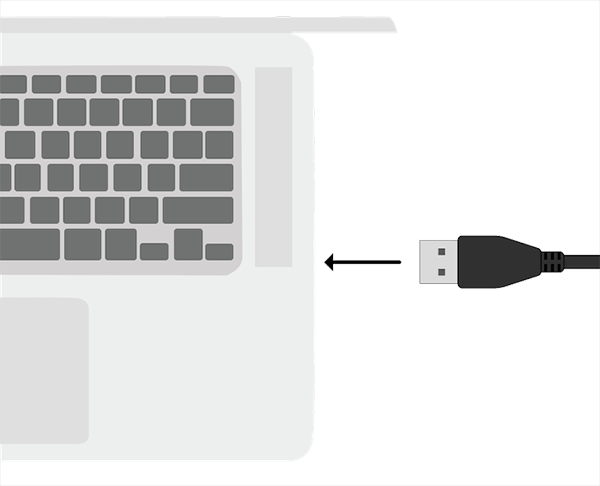
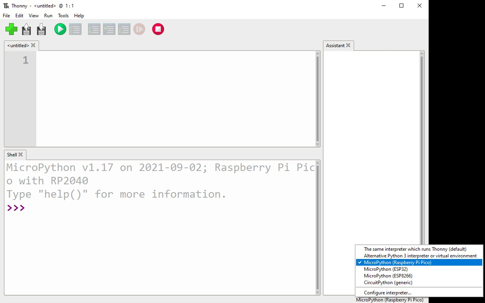

## 1A - Connect and test your Pico

Everyone does this first. Your starter already has a Pico check, so you can test the board before choosing an instrument.

## Step 1

> [!TASK]
>
> Download the [starter project](resources/instrument.py). Open it in Thonny and **save your own copy** as `instrument.py`.

## Step 2

> [!TASK]
>
> Connect your Pico with a USB **data** cable. In Thonny, choose **MicroPython (Raspberry Pi Pico)** as the interpreter.
>
> 
>
> 

## Step 3

> [!TASK]
>
> Run your starter. Its Pico check is:
>
> ```python
> from picozero import pico_led
> from time import sleep
>
> pico_led.on()
> sleep(1)
> pico_led.off()
> print("Pico and picozero are ready")
> ```

## Test

> [!TASK]
>
> Did the onboard LED light for one second? Did the Shell show **Pico and picozero are ready**? If so, your Pico is ready. Keep your copy of the starter as you try other pages.

> [!TIP]
>
> If Thonny cannot find the Pico, check the USB data cable and interpreter. If it says `No module named picozero`, install **picozero** through **Tools → Manage packages**.
>
> 

Choose a body, buzzer, sound or control next. You can change order at any time.
