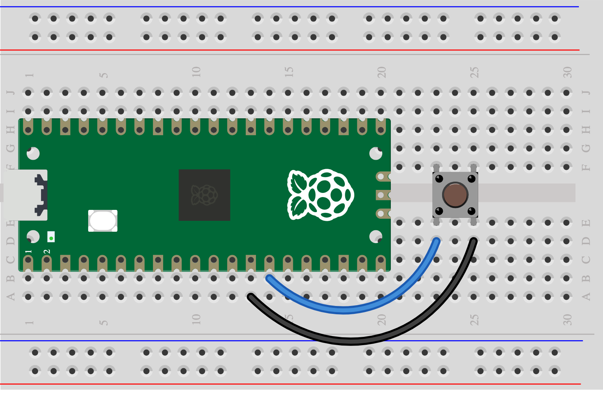

## 5A - Press or squeeze

A button or two bits of foil make a switch.

> [!CAUTION]
>
> First complete [1A - Connect and test your Pico](1A%20-%20Connect%20and%20test%20your%20Pico.md). You can explore this idea before wiring it.

## Step 1

> [!TASK]
>
> Gather a push button or foil and a card spacer.
>
> Connect GP10 through the switch to GND. A four-leg button has joined pairs: follow the picture.
>
> 

## Step 2

> [!TASK]
>
> Run the [Skills Bricks code](https://raspberrypifoundation.github.io/skills-bricks/button/button-pico.html) in Thonny:
>
> ```python
> from picozero import Button
>
> button = Button(10)
>
> pressed = button.is_pressed
> ```
>
> Add this underneath to see when your control detects an action:
>
> ```python
> print(pressed)
> if pressed:
>     print("Playing action detected!")
> ```

## Test

> [!TASK]
>
> Press and release. Run the code each time and look for True and False. Keep foil apart until pressed. Try a different action or change the number in the `if` line.

## Make it yours

Try a big pad, a small fret or a squeeze handle. Choose another control too if you want; each control needs its own signal pin.
