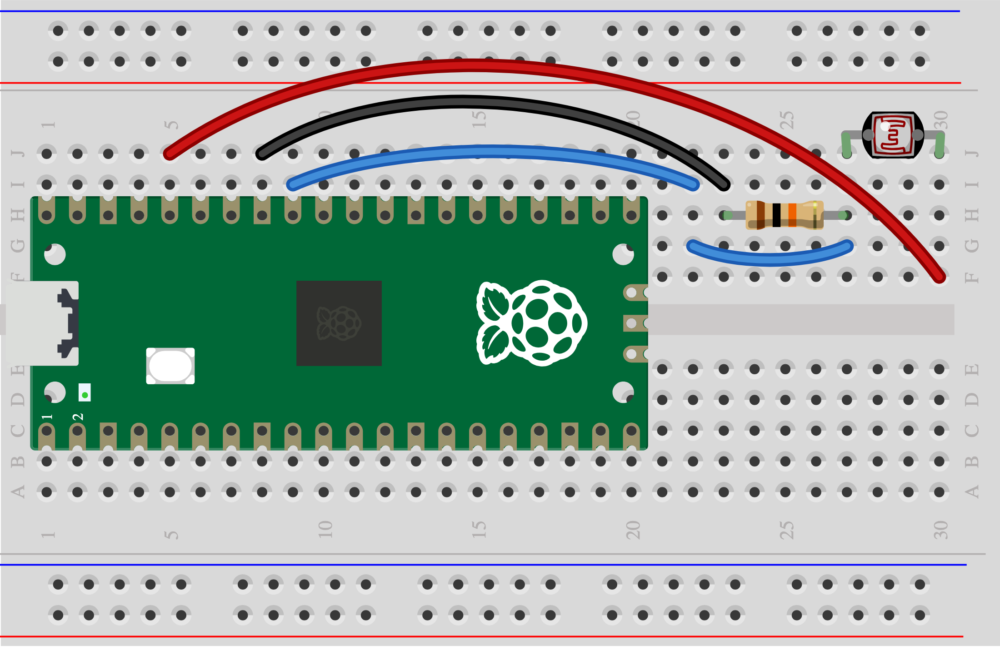

## 5D - Play with shadows

A shadow changes a light reading.

> [!CAUTION]
>
> First complete [1A - Connect and test your Pico](1A%20-%20Connect%20and%20test%20your%20Pico.md). You can explore this idea before wiring it.

## Step 1

> [!TASK]
>
> Gather an LDR, a 10 kΩ resistor and leads.
>
> Join the LDR and resistor at GP27. The LDR’s other leg goes to 3V3 OUT; the resistor’s other leg goes to GND.
>
> 

## Step 2

> [!TASK]
>
> Run the [Skills Bricks code](https://raspberrypifoundation.github.io/skills-bricks/ldr/ldr-pico.html) in Thonny:
>
> ```python
> from picozero import AnalogInputDevice
>
> ldr = AnalogInputDevice(27)
>
> light = ldr.value
> ```
>
> Add this underneath to see when your control detects an action:
>
> ```python
> print(light)
> if light < 0.5:
>     print("Playing action detected!")
> ```

## Test

> [!TASK]
>
> Cover and uncover it. With this wiring, darker gives a lower value. Try a different action or change the number in the `if` line.

## Make it yours

Cut a light window in your instrument body. Choose another control too if you want; each control needs its own signal pin.
