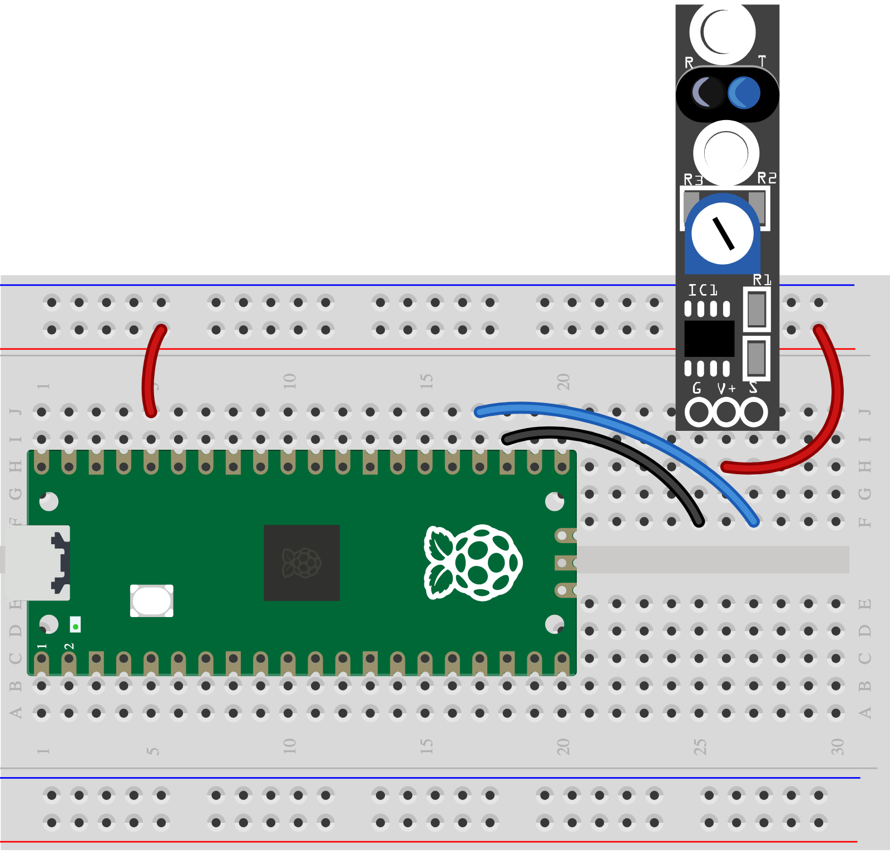

## 5G - Pull a pattern through

Move dark and light marks under a sensor to make a rhythm.

> [!TIP]
>
> First complete [1A - Connect and test your Pico](1A%20-%20Connect%20and%20test%20your%20Pico.md). You can explore this idea before wiring it.

## Step 1

> [!TASK]
>
> Gather a KY-033 line sensor, contrasting card and three leads.
>
> S goes to GP18, V+ to 3V3 OUT and G to GND.
>
> 

## Step 2

> [!TASK]
>
> Run the [Skills Bricks code](https://raspberrypifoundation.github.io/skills-bricks/line-sensor/line-sensor-pico.html) in Thonny:
>
> ```python
> from picozero import DigitalInputDevice
>
> line = DigitalInputDevice(18, pull_up=False)
>
> on_line = line.is_active
> ```
>
> Add this underneath to see when your control detects an action:
>
> ```python
> print(on_line)
> if on_line:
>     print("Playing action detected!")
> ```

## Test

> [!TASK]
>
> Move a marked strip under the sensor. Adjust its small dial until the reading changes. Try a different action or change the number in the `if` line.

## Make it yours

Make a hand-cranked rhythm wheel. Choose another control too if you want; each control needs its own signal pin.
