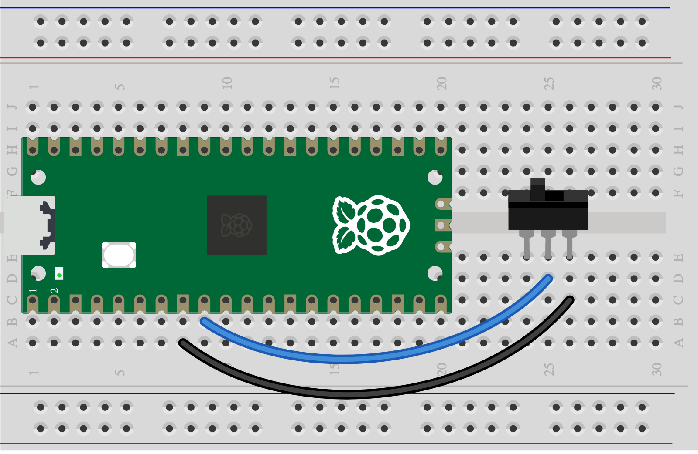

## 5H - Flip a switch

A toggle stays in its chosen position.

> [!TIP]
>
> First complete [1A - Connect and test your Pico](1A%20-%20Connect%20and%20test%20your%20Pico.md). You can explore this idea before wiring it.

## Step 1

> [!TASK]
>
> Gather an SPDT toggle switch and two leads.
>
> Connect COM (centre leg) to GP6 and one outside leg to GND. Leave the other outside leg unconnected.
>
> 

## Step 2

> [!TASK]
>
> Run the [Skills Bricks code](https://raspberrypifoundation.github.io/skills-bricks/toggle-switch/toggle-switch-pico.html) in Thonny:
>
> ```python
> from picozero import Switch
>
> mode = Switch(6)
>
> mode_two = mode.is_closed
> ```
>
> Add this underneath to see when your control detects an action:
>
> ```python
> print(mode_two)
> if mode_two:
>     print("Playing action detected!")
> ```

## Test

> [!TASK]
>
> Flip the switch each way and run again. Use it to choose a playing mode. Try a different action or change the number in the `if` line.

## Make it yours

Choose between two rhythms or sound rules. Choose another control too if you want; each control needs its own signal pin.
