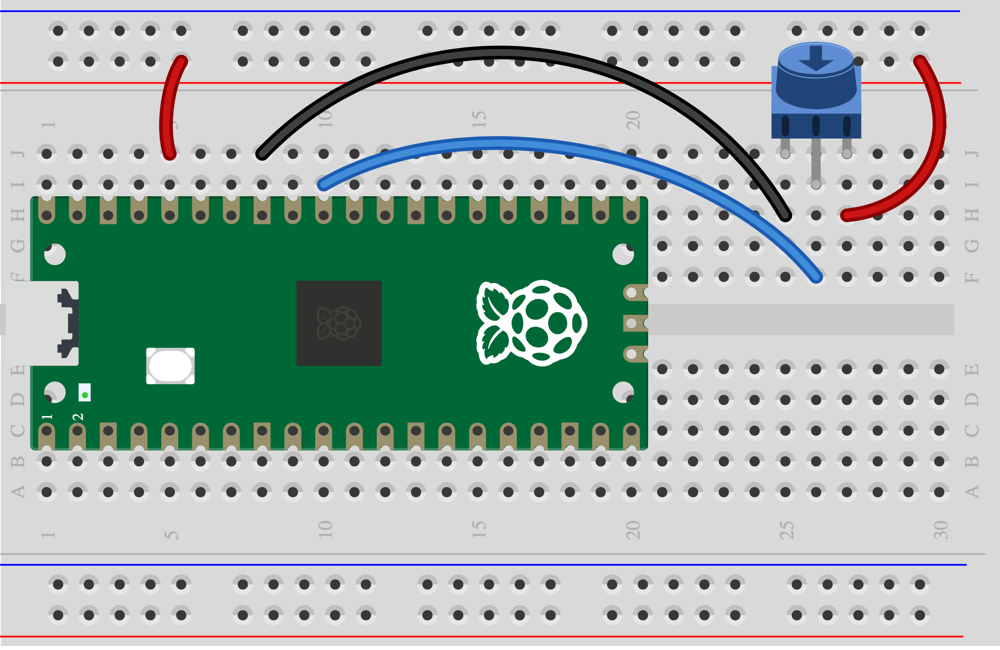

## 6B - Give two controls a job

Two actions can work together. One might start a sound while the other changes its pitch or pulse speed.

> [!TIP]
>
Have you tested both controls and your buzzer? Follow the relevant [control pages](5A%20-%20Press%20or%20squeeze.md) and [buzzer page](3B%20-%20Passive%20buzzer.md), then return. Give each control its own GP pin and share GND.

## Step 1

> [!TASK]
>
This example joins the Skills Bricks **button**, **potentiometer** and **passive buzzer** circuits. A held button starts the sound; the dial changes pitch. GP10 goes through the button to GND; pot middle leg goes to GP26, its ends to 3V3 OUT and GND; buzzer + goes to GP9 and − to GND.
>
> 
>
> 
>
> 

## Step 2

> [!TASK]
>
Start with the [button](https://raspberrypifoundation.github.io/skills-bricks/button/button-pico.html), [dial](https://raspberrypifoundation.github.io/skills-bricks/potentiometer/potentiometer-pico.html) and [buzzer](https://raspberrypifoundation.github.io/skills-bricks/passive-buzzer/passive-buzzer-pico.html) snippets. Add the rule:
>
> ```python
> from picozero import Button, Pot, PWMBuzzer
> from time import sleep
>
> button = Button(10)
> pot = Pot(26)
> buzzer = PWMBuzzer(9, 2000, 32768)
>
> try:
>     while True:
>         if button.is_pressed:
>             buzzer.freq = int(220 + pot.value * 660)
>             buzzer.on()
>         else:
>             buzzer.off()
>         sleep(0.01)
> finally:
>     buzzer.off()
> ```

## Test

> [!TASK]
>
Hold the button and turn the dial. What happens when you release the button? Try swapping the jobs or inventing a rule with two different controls. If two Skills Bricks cards use the same pin, choose another free pin and change its number in code.
