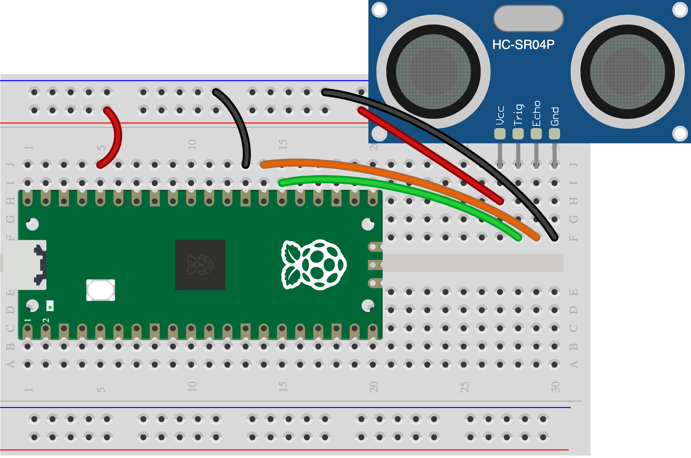

## 8D - Pico theremin idea

Borrow the **play in the air** idea. A distance sensor can bend the pitch; a dial or second sensor can change the pulse speed. A dial alone is also an option.

> [!TIP]
>
Have you tested a [distance sensor](5E%20-%20Play%20in%20the%20air.md) or [dial](5C%20-%20Turn%20a%20dial.md), and a [passive buzzer](3B%20-%20Passive%20buzzer.md)? Test only the controls you choose.

## Step 1

> [!TASK]
>
For one-hand play, use a **3.3 V-compatible HC-SR04P**: Trig **GP20**, Echo **GP21**, VCC **3V3 OUT**, GND **GND**. Passive buzzer **+ → GP9**, **− → GND**. Do not use a 5 V Echo module directly on a Pico pin.
>
> 
>
> 

## Step 2

> [!TASK]
>
The [Skills Bricks distance snippet](https://raspberrypifoundation.github.io/skills-bricks/distance/distance-pico.html) starts with `DistanceSensor(echo=21, trigger=20)`. The complete [one-hand Pico theremin program](resources/examples/pico-theremin.py) changes pitch as your hand moves:
>
> ```python
> distance = hand.distance
> if distance is None or distance > 0.6:
>     buzzer.off()
> else:
>     buzzer.freq = int(220 + (0.6 - distance) * 1000)
>     buzzer.on()
> ```

## Choose another control

- **Dial only:** pot middle leg **GP26**, ends **3V3 OUT** and **GND**. Use the [dial wiring](images/potentiometer-wiring.png) and [dial-only program](resources/examples/pico-theremin-dial.py). No distance sensor is needed.
- **Hand and dial:** keep the first sensor; add the pot on **GP26** to change pulse speed. Use the [hand-and-dial program](resources/examples/pico-theremin-hand-dial.py).
- **Two hands:** keep the first sensor; give a second HC-SR04P Trig **GP18**, Echo **GP19**, VCC **3V3 OUT**, GND **GND**. Point the sensors apart. Use the [two-hand program](resources/examples/pico-theremin-two-hands.py).

## Test

> [!TASK]
>
Move one hand slowly. Try the dial or second hand if you added one. If there is no echo, the distance program goes quiet. Change the pitch range to make your own sound.
