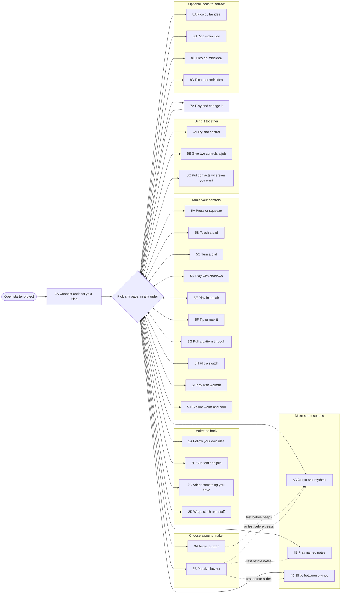

# Pathway map

The [page-level flowchart](step-dependencies.mermaid) shows each learner page as a node. The **only required start** is `1A - Connect and test your Pico`. Open the starter and get the LED and Shell message working on a real Pico before using another page.

After that, choose pages in any order. These groups are a menu, not a sequence:

- **Make the body:** `2A` own idea, `2B` cut/fold/join, `2C` adapt an object, `2D` wrap/stitch/stuff. Mix methods.
- **Choose a sound maker:** `3A` active buzzer or `3B` passive buzzer. Use one on GP9 at a time.
- **Make some sounds:** `4A` beeps and rhythms, `4B` named notes, `4C` pitch slides. Named notes and slides need a passive buzzer.
- **Make your controls:** `5A` press, `5B` touch, `5C` dial, `5D` shadow, `5E` distance, `5F` tilt, `5G` line sensor, `5H` switch, `5I` temperature, `5J` temperature probe. Choose one or several.
- **Bring it together:** `6A` one control, `6B` two controls, `6C` repeated contacts. These are examples of ways to combine parts, not prescribed builds.
- **Play and change it:** `7A` is the finish when the learner has a playable instrument. They may go back and change anything.
- **Optional ideas to borrow:** `8A` Pico guitar, `8B` Pico violin, `8C` Pico drumkit, `8D` Pico theremin. Borrow a technique without copying the whole instrument.

Possible routes include `1A → 2A → 5A → 3B → 6A → 7A` (body first), `1A → 3B → 4B → 5C → 6A → 7A` (sound first), and `1A → 5A → 3A → 4A → 6A → 7A` (controls first). These are examples; learners can switch route at any point.

## Page-level flowchart

Every numbered learner page is a node. The central choice point means the learner can move between pages after testing the Pico. Dotted arrows show useful checks, not locked routes.

<!-- BEGIN GENERATED FLOWCHART -->

<!-- END GENERATED FLOWCHART -->
